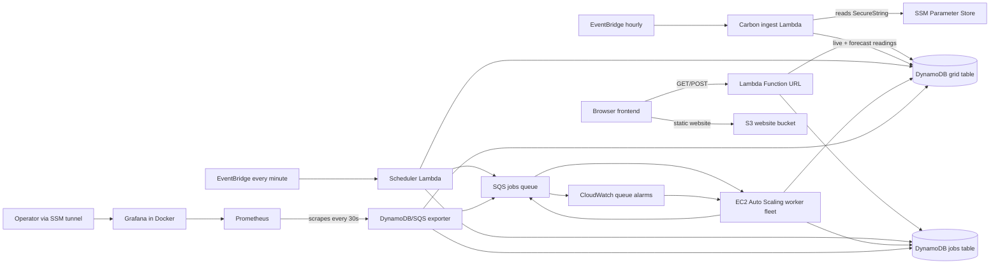

# GreenQueue

GreenQueue is a carbon-aware job scheduling demo. It accepts flexible CPU-burn jobs, waits for a cleaner grid-intensity window when the deadline allows, and runs work on EC2 workers that scale with the SQS backlog. A static S3-hosted frontend shows job state and grid intensity; Prometheus and Grafana provide operational metrics.

> **Measurement caveat:** the worker's energy and CO₂ values are model-based estimates, not direct power measurements. The worker currently runs a timed CPU-burn demo rather than arbitrary user-provided scripts.

## Architecture



### Job lifecycle

1. `POST /jobs` creates a `PENDING` job in `GreenQueueJobs`.
2. The scheduler checks grid intensity and the job deadline. It leaves flexible work pending when a cleaner forecast is available; otherwise it marks the job `QUEUED` and sends a message to SQS.
3. EC2 workers receive SQS messages, run the CPU-burn demonstration, and update the DynamoDB job to `DONE` with estimated energy and emissions.
4. Failed messages are retried by SQS and can be moved to `greenqueue-jobs-dlq` after repeated receives.

The scheduler uses Electricity Maps live/forecast values saved in `GreenQueueGrid` when available, and falls back to an illustrative profile when data is missing. The API also includes a manual grid override for demonstrations.

## AWS resources

Terraform in this repository provisions:

- **Lambda:** API, scheduler, and hourly Electricity Maps ingest.
- **EventBridge:** scheduler every minute; carbon ingest hourly.
- **DynamoDB:** `GreenQueueJobs` and `GreenQueueGrid`, on-demand billing.
- **SQS:** jobs queue and dead-letter queue.
- **EC2 Auto Scaling:** worker fleet, configured for zero to three `t3.micro` instances by default.
- **Monitoring EC2:** Prometheus, the GreenQueue exporter, and Grafana in Docker.
- **S3 static website:** public `index.html` and Terraform-generated `config.js`.
- **IAM:** Lambda, ingest, worker, and monitoring roles/profiles.

The default AWS region is `ap-south-1`; the default Electricity Maps zone is `IN-NO`. Both can be changed in `variables.tf` or with Terraform variable overrides.

## Prerequisites

- Terraform `>= 1.5.0`.
- AWS CLI credentials for the target account, with permissions to manage the resources above.
- A current Electricity Maps API token with access to the selected zone.
- AWS Session Manager plugin on your computer if you want to tunnel to Grafana/Prometheus using SSM.

### Store the Electricity Maps token

Create this parameter **before relying on ingestion** in AWS Systems Manager → Parameter Store:

- Name: `/greenqueue/electricitymaps/api-key` (or the value of `em_api_key_parameter_name`).
- Type: `SecureString`.
- Value: your Electricity Maps API token.

The ingest Lambda reads the token at runtime. The token is not embedded in the S3 website or exposed to browser JavaScript. Do not commit API tokens, `.tfvars`, Terraform state, or credentials to source control.

## Deploy

From the repository root:

```sh
terraform init
terraform fmt -check -recursive
terraform validate
terraform plan
terraform apply
```

Review the plan before applying. To retrieve the deployed public URLs:

```sh
terraform output -raw frontend_url
terraform output -raw api_url
```

Open the `frontend_url` output in a browser. Terraform uploads the frontend and generates `config.js` from the deployed Lambda Function URL, so no manual API URL copy/paste is needed. After editing `frontend/index.html`, run `terraform apply` to upload the updated page.

### Test ingestion

The EventBridge rule runs ingestion hourly. To test immediately:

```sh
aws lambda invoke \
  --region ap-south-1 \
  --function-name greenqueue-ingest \
  --cli-binary-format raw-in-base64-out \
  --payload '{}' \
  /tmp/greenqueue-ingest-result.json
cat /tmp/greenqueue-ingest-result.json
```

A successful response includes a latest reading and a forecast-hour count. The current and forecast records can also be read from the frontend API's `GET /grid` endpoint.

## API

`api_url` is a public Lambda Function URL. The frontend is configured to use it automatically. Current routes:

| Method | Path | Purpose |
| --- | --- | --- |
| `POST` | `/jobs` | Submit a job. JSON fields include `workload`, `duration_minutes`, and `deadline_minutes`. |
| `GET` | `/jobs` | List jobs and their status/results. |
| `GET` | `/grid` | Read hourly grid data and any override. |
| `POST` | `/override` | Set `{ "intensity": 800 }`; send `{ "intensity": null }` to return to automatic grid data. |

Example job request:

```sh
API_URL="$(terraform output -raw api_url)"
curl -X POST "${API_URL}jobs" \
  -H 'content-type: application/json' \
  -d '{"workload":"cpu-burn","duration_minutes":1,"deadline_minutes":15}'
```

The `workload` field is currently descriptive: workers execute the fixed CPU-burn demo, not code supplied in that field.

## Monitoring

### Prometheus and Grafana

Prometheus scrapes the GreenQueue exporter every 30 seconds. The exporter reads job/grid data from DynamoDB and queue depth from SQS. Grafana is provisioned with the `GreenQueue Prometheus` data source and a dashboard whose source of truth is [`modules/monitoring/greenqueue-dashboard.json`](modules/monitoring/greenqueue-dashboard.json).

The monitoring EC2 has no inbound security-group rules. Use SSM port forwarding to access Grafana:

```sh
aws ssm start-session \
  --target "$(terraform output -raw monitoring_instance_id)" \
  --document-name AWS-StartPortForwardingSession \
  --parameters '{"portNumber":["3000"],"localPortNumber":["3001"]}'
```

Keep that session running, then visit `http://localhost:3001`. The current Grafana setup script initializes the admin login as `admin` / `admin`; change it before sharing access. Prometheus can be forwarded similarly by mapping remote port `9090` to a free local port (for example `9091`).

The dashboard includes job counts, SQS depth, estimated energy/emissions, grid intensity/forecast, exporter scrape health, and exporter refresh age. Useful PromQL includes:

```promql
greenqueue_jobs
sum(greenqueue_estimated_emissions_gco2{basis="completion_intensity_estimate"})
greenqueue_grid_intensity_forecast_gco2_per_kwh
greenqueue_sqs_messages
up{job="greenqueue-dynamodb"}
```

## Important security and cost notes

- The Lambda Function URL currently allows unauthenticated public access. Anyone who gets its URL can read job/grid data, submit work, or change the grid override. Restrict/authenticate the API before sharing the site widely.
- The S3 website bucket is publicly readable by design and uses the S3 **HTTP website endpoint** (not HTTPS). Use CloudFront with HTTPS and a private S3 origin for a production-style deployment.
- Do not put the Electricity Maps token in frontend configuration. Only the public Lambda URL belongs in `config.js`.
- AWS usage may incur charges: the monitoring EC2 remains on, worker EC2 instances incur cost while running, and DynamoDB/SQS/Lambda/S3/egress usage may be billable. Check the AWS billing console and destroy demo resources when no longer needed.
- Prometheus retains three days of metrics on the monitoring instance. Replacing/destroying that instance removes its local Prometheus history. Grafana dashboard definitions are reproducible from the repository.

## Repository layout

```text
frontend/                 Static browser app and Terraform config template
lambda_src/api/           Public job/grid API Lambda
lambda_src/ingest/        Electricity Maps live/forecast ingestion Lambda
lambda_src/scheduler/     Carbon-aware job release scheduler Lambda
worker/                   EC2 SQS worker and estimate calculation
modules/database/         DynamoDB tables
modules/iam/              Lambda, ingest, worker, and monitoring IAM
modules/lambdas/           Lambda functions and EventBridge rules
modules/monitoring/        Prometheus, exporter, Grafana, dashboard
modules/queue/             SQS jobs queue and dead-letter queue
modules/workers/           EC2 launch template, ASG, and queue-depth alarms
modules/frontend/          Public S3 static website and uploaded assets
```
